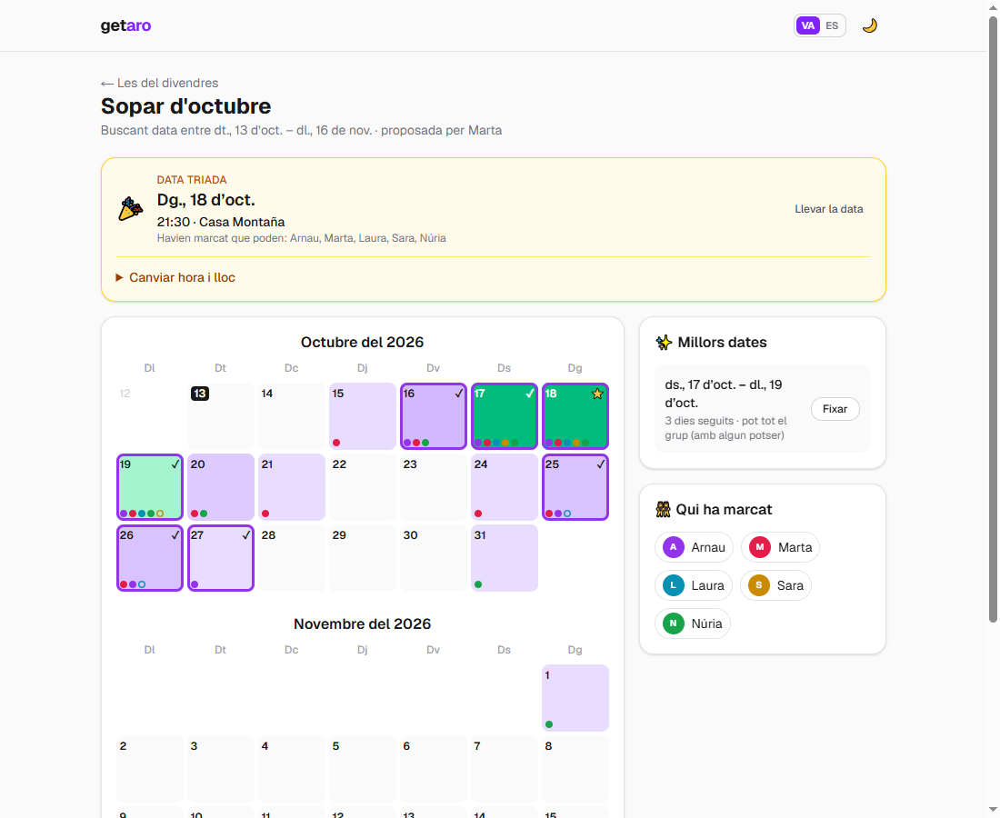
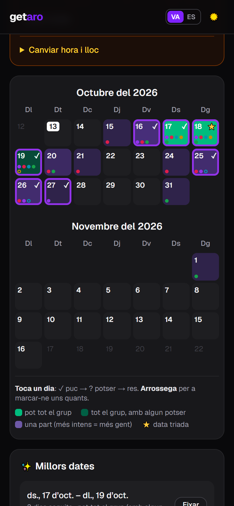
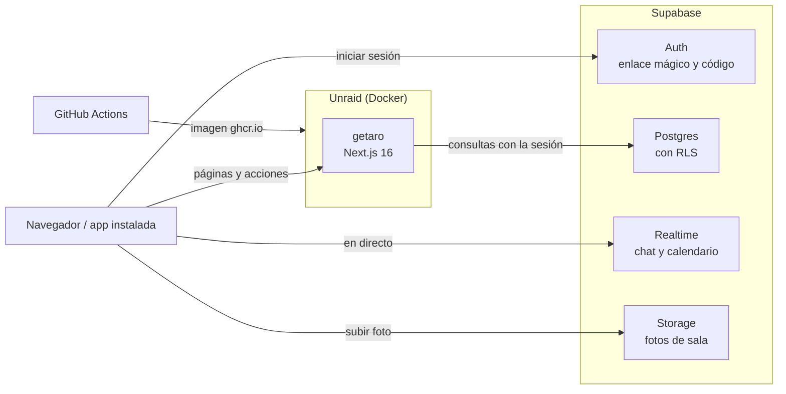

# getaro

**Cuadra quedadas con tu grupo sin perderte en el chat de WhatsApp.**

getaro es una webapp para organizar quedadas entre amigos. Cada grupo tiene su **sala**; dentro de la sala se proponen
**quedadas** ("Sopar d'octubre", "Cap de setmana a la platja"), cada persona marca en un calendario compartido los días
que puede, y la app enseña de un vistazo qué días y qué rachas de días os van bien a todos. Cuando hay acuerdo, se fija la
fecha con hora y lugar.

Está en **valencià** por defecto y en **castellano**, funciona en el móvil (se puede instalar como app) y tiene modo
oscuro.

<table>
  <tr>
    <td></td>
    <td></td>
  </tr>
</table>

## Qué se puede hacer

- **Salas privadas.** Se entra con un enlace de invitación. La persona titular puede exigir aprobación para entrar,
  expulsar, pasar la sala a otra persona y ponerle una foto o un emoji.
- **Calendario compartido por quedada.** Tocar un día rota entre *puc*, *potser* y nada; arrastrar marca varios días.
  Verde intenso: puede todo el grupo. Verde claro: todo el grupo, con algún *potser*. Violeta: una parte (más intenso,
  más gente). Se actualiza en directo cuando otra persona marca.
- **Millors dates.** La app calcula las rachas de días consecutivos en las que puede más gente y permite fijar una con
  un toque. Al fijarla se añade la hora y el lugar, y aparece en "Pròximes quedades" al entrar.
- **Chat por sala** en tiempo real, con contador de mensajes sin leer y carga de mensajes antiguos.
- **Panel de administración**: personas activas por día, cuentas, salas, historial de acciones delicadas y estado del
  sistema.
- **Ajustes personales**: nombre, color en los calendarios, cómo quieres que te trate la app (femenino, masculino o
  neutro), idioma y tema.

## Cómo funciona



- **Next.js** renderiza las páginas en el servidor y ejecuta las acciones (crear sala, fijar fecha...) como *server
  actions*. No hay API propia: el servidor habla con Supabase usando la sesión de quien navega.
- **Toda la seguridad está en la base de datos.** Cada tabla tiene políticas RLS ("solo los miembros ven los mensajes
  de su sala", "solo la titular cambia la sala"...) y las operaciones delicadas son funciones SQL que comprueban
  permisos. Aunque alguien llamara a Supabase directamente, saltándose la web, no podría hacer más que desde la app.
  Detalles en [`docs/DATABASE.md`](docs/DATABASE.md).
- **Tiempo real**: el navegador se suscribe a los cambios de mensajes y disponibilidad con Supabase Realtime, que
  respeta las mismas políticas.
- **La imagen Docker no lleva claves.** La URL y la clave pública de Supabase se leen al arrancar el contenedor y se
  pasan al navegador desde la página, así una misma imagen sirve para cualquier instalación.
- **Supabase gratis se pausa tras 7 días sin uso.** El servidor hace una consulta ligera al arrancar y cada 24 horas
  ([`instrumentation.ts`](instrumentation.ts)) para evitarlo.

## Tecnología

| Parte | Elección |
|-------|----------|
| Web | Next.js 16 (App Router, server actions, `proxy.ts`), React 19, TypeScript |
| Estilos | Tailwind CSS 4 |
| Datos, login y tiempo real | Supabase: Postgres con RLS, Auth, Realtime y Storage |
| Validación | Zod |
| Tests | Vitest |
| Despliegue | Docker (Next.js `standalone`), imagen en GitHub Container Registry, Unraid |

## Estructura

```
app/
  actions.ts                      todas las server actions (salas, quedadas, perfil, admin)
  page.tsx                        inicio: mis salas, próximas quedadas, crear o unirse
  login/  auth/                   inicio de sesión (enlace, código, Google) y vuelta del correo
  join/[code]/                    página del enlace de invitación
  rooms/[id]/                     sala: pestañas Quedades, Xat y Gent
  rooms/[id]/events/[eventId]/    calendario de una quedada (EventCalendar.tsx)
  settings/  admin/  unavailable/
  manifest.ts                     instalable en el móvil
components/                       piezas compartidas (cabecera, avatares, formularios, idioma, tema)
lib/
  supabase/                       clientes de Supabase para servidor y navegador
  i18n/                           textos en valencià y castellano
  availability.ts  dates.ts       lógica del calendario (con tests)
  auth.ts  room.ts  config.ts     sesión, contexto de sala y configuración
supabase/
  migrations/                     esquema de la base de datos, en orden
  email-templates/                correos de inicio de sesión
docs/                             especificación, base de datos, admin y despliegue
proxy.ts                          protege las rutas y renueva la sesión
instrumentation.ts                mantiene despierto Supabase
```

## Desarrollo local

Requisitos: Node 22 o superior y un proyecto de Supabase (el plan gratis basta).

1. Aplica las migraciones de [`supabase/migrations`](supabase/migrations) en orden (SQL Editor de Supabase, o con el
   conector de Supabase). Ver [`docs/DATABASE.md`](docs/DATABASE.md).
2. Copia `.env.example` a `.env.local` y pon la *Project URL* y la *Publishable key* (Supabase, Project Settings, API).
3. En Supabase, Authentication, URL Configuration, añade `http://localhost:3000/**` a Redirect URLs.
4. Arranca:

   ```bash
   npm install
   npm run dev
   ```

5. Entra en http://localhost:3000 con tu correo. Para tener el panel de administración, ejecuta una vez en el SQL Editor:

   ```sql
   update public.profiles set is_admin = true
   where id = (select id from auth.users where email = 'TU_CORREO');
   ```

En desarrollo, la pantalla de login tiene un **acceso de pruebas** con contraseña para cuentas creadas a mano en
Supabase (Authentication, Users, Add user, marcando *Auto Confirm*). En producción no aparece.

### Correo

- **Envío**: el correo que trae Supabase solo llega a los miembros de tu organización de Supabase. Para que entre
  cualquiera, configura un SMTP propio (por ejemplo Resend) en Authentication, Emails, SMTP Settings.
- **Plantillas**: las de [`supabase/email-templates`](supabase/email-templates/README.md) incluyen el enlace y un
  código. El código permite entrar aunque el enlace se abra dentro de Gmail o WhatsApp, o en otro dispositivo.
- **Google** (opcional): si lo activas en Authentication, Providers, el botón aparece solo en el login.

## Despliegue

Cada push a `main` pasa las comprobaciones y publica la imagen `ghcr.io/arnaupool/getaro:latest`
([workflow](.github/workflows/docker.yml)). En Unraid se instala una vez desde el formulario de Docker y se actualiza
con un clic. Paso a paso, incluido el acceso desde fuera con Cloudflare Tunnel: [`docs/DEPLOY.md`](docs/DEPLOY.md).

## Comandos

| Comando | Qué hace |
|---------|----------|
| `npm run dev` | Servidor de desarrollo en http://localhost:3000 |
| `npm run check` | Tipos, lint y tests: lo mismo que comprueba GitHub antes de publicar |
| `npm test` | Tests en modo vigilancia |
| `npm run format` | Formatea todo el código con Prettier |
| `npm run build` | Build de producción |

## Documentación

- [`docs/SPEC.md`](docs/SPEC.md): qué hace la app y por qué, decisiones y permisos.
- [`docs/DATABASE.md`](docs/DATABASE.md): tablas, modelo de seguridad, migraciones y cómo probarlas.
- [`docs/ADMIN.md`](docs/ADMIN.md): diseño del panel de administración.
- [`docs/DEPLOY.md`](docs/DEPLOY.md): instalación en Unraid.
